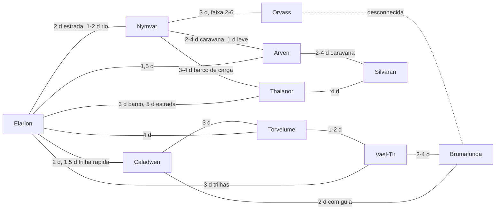

# Aeltharyn — Mapa esquemático (M2.1)

**Não é cartografia.** Grafo das ligações do doc 07 e posição relativa só onde o texto do doc 01 (seções 2.1 e 5) a sustenta. Nenhuma coordenada ou escala foi criada. Linhas tracejadas = duração desconhecida. Dias entre parênteses = condições comuns, como no doc 07.

## 1. Grafo das ligações

## 2. Posição relativa sustentada pelo texto

| Cidade | O que o doc 01 diz |
|---|---|
| Elarion | junto ao Rio Lúmen, que nasce ao norte e vai ao litoral oriental |
| Thalanor | enseada na Costa de Âmbar (leste), perto da foz do Lúmen |
| Nymvar | confluência dos três braços do Rio das Três Vozes |
| Arven | clareiras ao **sul de Elarion** |
| Orvass | Pântano de Orvass, zona **meridional** |
| Torvelume | passagem entre a floresta e a Espinha de Vidro, **noroeste**, perto de galerias antigas |
| Caladwen | colina ao lado do Lago das Lanternas |
| Brumafunda | limite do Bosque dos Sussurros, zona de neblina |
| Vael-Tir | borda da Mata Primordial |
| Silvaran | vale onde quatro trilhas antigas se encontram |

Sem posição cardinal no texto: Nymvar, Caladwen, Brumafunda, Vael-Tir e Silvaran. Elevações antigas a oeste e norte; litoral a leste; pântanos ao sul.

## 3. Corredores

| Corredor | Cidades |
|---|---|
| Eixo do Lúmen | Elarion–Nymvar–Thalanor |
| Corredor das Copas | Elarion–Vael-Tir–Brumafunda |
| Rota dos Celeiros | Nymvar–Arven–Silvaran |
| Estrada da Espinha | Caladwen–Torvelume–Vael-Tir |
| Rota do Pântano | Orvass–Nymvar e Orvass–Brumafunda (esta sem duração) |

## 4. Lacunas

- Orvass–Brumafunda: duração desconhecida.
- Acessos e durações dos 20 assentamentos: doc 07, seção 3.1.
- Cidades sem ligação direta nos docs (ex.: Silvaran–Elarion, Caladwen–Arven) não são impossíveis: só não têm caminho fixado.
