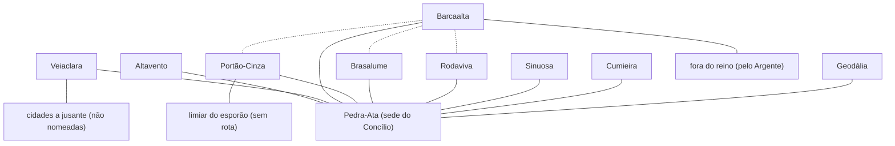

# Coroas de Pedra — mapa esquemático (doc 07)

**Estado:** rascunho de R2-3.1 para aprovação do autor · **Data:** 2026-11-04 · **Etiqueta:** [PROPOSTO]. Esquema **de relações**, não cartografia: sem escala, sem distância, sem posição norte-sul além do que M-04 já fixa. Fonte: `07-registro-operacional-de-rotas.md`.

## 1. O que o desenho mostra

Linhas contínuas = ligação **documentada sem duração**; linhas tracejadas = **sugerida por dependência**. Cidades sem linha entre si **não** estão desligadas; só não têm evidência. Nenhuma linha leva a Aeltharyn.

## 2. Posição relativa que já é cânone

| Fato | Fonte |
|---|---|
| as Coroas ficam ao norte e noroeste do continente | M-04 G-02, G-03 |
| os Dentes de Brasa ficam no extremo norte; Brasalume é a "Forja dos Dentes" | M-04 G-05; doc 01 |
| o Argente nasce nas Coroas e corre para o sul pelas Marcas das Feras | M-04 G-06 |
| a Espinha de Vidro é o braço sul da cordilheira, zona-tampão para Aeltharyn; Portão-Cinza fica no limiar do esporão | M-04 G-04; doc 01 |
| a nascente do Lúmen fica nas encostas das Coroas | M-04 G-03 |

O que o desenho **não** decide: distâncias, altitudes, quantas jornadas separam duas cidades, onde passam as fronteiras, onde ficam Cumieira, Rodaviva, Geodália e Sinuosa em relação às demais.
