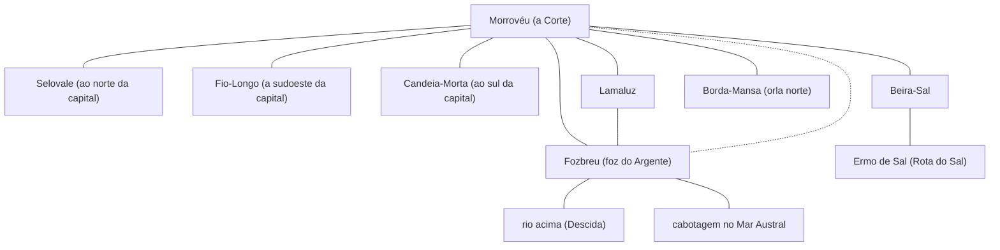

# Véu dos Malditos — mapa esquemático (doc 07)

**Estado:** rascunho de R3-3.1 para aprovação do autor (D-79) · **Data:** 2026-11-05 · **Etiqueta:** [PROPOSTO]. Esquema **de relações**, não cartografia: sem escala, sem distância, sem posição norte-sul fora do que o doc 01 diz da capital. Fonte: `07-registro-operacional-de-rotas.md`.

## 1. O que o desenho mostra

Linhas contínuas = ligação **documentada sem duração**; tracejadas = **sugerida por dependência**. Lugares sem linha entre si **não** estão desligados; só não têm evidência. O traço do Conselho (cada lugar ↔ Morrovéu) é político, não um caminho. Nenhuma linha liga o Véu a Aeltharyn.

As linhas de Morrovéu para os sete lugares representam o assento no Conselho. A linha tracejada Morrovéu–Fozbreu é a única sugerida por dependência; como já existe o traço do Conselho entre os dois, ela só marca a facção comum (Defensores da Paz).

## 2. Posição relativa que já é cânone

| Lugar | O que o doc 01 diz | Fonte |
|---|---|---|
| Morrovéu | no meio do vale, num morro seco | V-01 |
| Selovale | num vale ao norte da capital | V-05 |
| Fio-Longo | num vale a sudoeste da capital | V-07 |
| Candeia-Morta | num vale ao sul da capital | V-08 |
| Lamaluz | no coração dos charcos do vale, à margem do rio | V-02 |
| Fozbreu | na foz do Argente, sobre o Mar Austral | V-03 |
| Beira-Sal | no limite seco do vale, junto ao Ermo de Sal | V-04 |
| Borda-Mansa | na orla norte do reino | V-06 |

Nenhuma outra relação de posição é afirmada; não há distância entre lugares.

## 3. Decisão pendente

**D-79** (ver `07-registro-operacional-de-rotas.md` §6).
