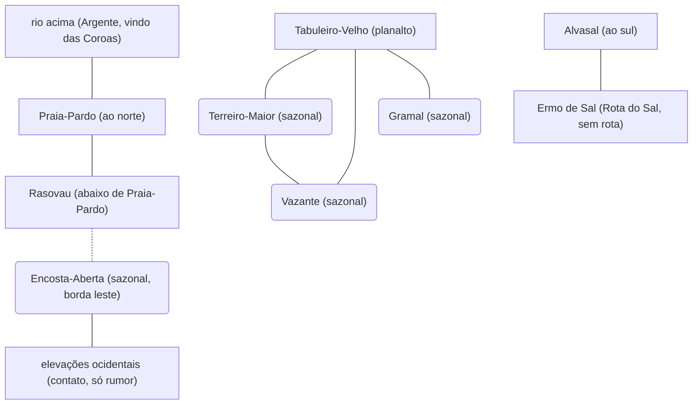

# Vale Palancar — mapa esquemático (doc 07)

**Estado:** R4-3.1, D-116 aceita pela continuação · **Data:** 2026-11-07 · **Etiqueta:** [PROPOSTO]. Esquema **de relações**, não cartografia: sem escala, sem distância, sem posição fora do que o doc 03 §2 diz. Fonte: `07-registro-operacional-de-rotas.md`.

## 1. O que o desenho mostra

Linhas contínuas = ligação **documentada sem duração**; tracejadas = **sugerida por dependência**. Lugares sem linha entre si **não** estão desligados; só não têm evidência. Lugares sazonais (caixas arredondadas) **mudam de campo com a migração**: a linha vale para o campo em que estiverem. Os traços do lugar-mãe são vínculos políticos, não caminhos. Nenhuma linha liga o Vale a Aeltharyn, às Coroas ou ao Véu; os nós de fora são **contatos permitidos**, não rotas.

## 2. Posição relativa que já é cânone

| Lugar | O que o doc 03 §2 diz | Fonte |
|---|---|---|
| Praia-Pardo | ao norte, onde o Argente chega vindo das Coroas | VP-03 |
| Rasovau | no curso do Argente, abaixo de Praia-Pardo | VP-02 |
| Alvasal | ao sul, na borda do Ermo de Sal | VP-04 |
| Tabuleiro-Velho | sobre o planalto, com vista para a planície do Argente | VP-01 |
| Encosta-Aberta | na borda leste, no pé das elevações voltadas a Aeltharyn (sazonal) | VP-07 |
| Terreiro-Maior, Vazante, Gramal | onde a migração estiver (sazonais); sem posição fixa | VP-05, VP-06, VP-08 |

Nenhuma outra relação de posição é afirmada; não há distância entre lugares.

## 3. Decisão pendente

**D-116** (ver `07-registro-operacional-de-rotas.md` §6).
