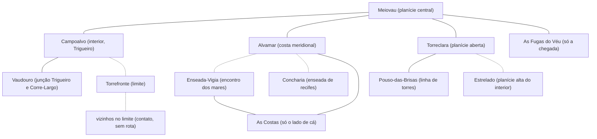

# Azeroth — mapa esquemático (doc 07)

**Estado:** R5-3.1, D-153 aceita pela continuação · **Data:** 2026-11-07 · **Etiqueta:** [PROPOSTO]. Esquema **de relações**, não cartografia: sem escala, sem distância, sem posição fora do que o doc 03 §2 diz. Fonte: `07-registro-operacional-de-rotas.md`.

## 1. O que o desenho mostra

Linhas contínuas = ligação **documentada sem duração**; tracejadas = **sugerida por dependência**. Lugares sem linha entre si **não** estão desligados; só não têm evidência. Todos os lugares são fixos. As caixas de "fora do reino" mostram só os fluxos permitidos (As Costas e As Fugas do Véu), **sem rota**.

## 2. Posição relativa que já é cânone

| Lugar | O que o doc 03 §2 diz | Fonte |
|---|---|---|
| Campoalvo | no interior, num ponto largo do Rio Trigueiro | AZ-01 |
| Vaudouro | na junção do Trigueiro com o Corre-Largo, entre o interior e a costa | AZ-02 |
| Torrefronte | no limite do reino, voltada ao lado de Aeltharyn e do Véu; sem rota | AZ-03 |
| Alvamar | na costa meridional, numa baía do Mar Austral | AZ-04 |
| Enseada-Vigia | na costa onde o Mar Austral e o Mar de Âmbar se encontram, ao sul das terras humanas | AZ-05 |
| Concharia | numa enseada de recifes da costa sul | AZ-06 |
| Torreclara | numa planície aberta e plana, de vista longa | AZ-07 |
| Estrelado | numa planície alta e seca do interior, longe de rio e de cidade | AZ-08 |
| Pouso-das-Brisas | entre o interior e a costa, na linha de torres que liga Torreclara ao litoral | AZ-09 |
| Meiovau | na planície central, onde as terras das três coroas se tocam | AZ-10 |

Nenhuma outra relação de posição é afirmada; não há distância entre lugares.

## 3. Decisão pendente

**D-153** (ver `07-registro-operacional-de-rotas.md` §6).
